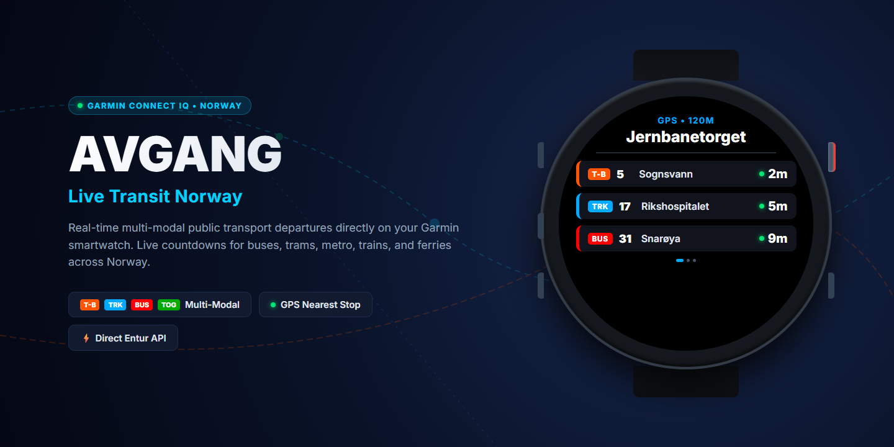
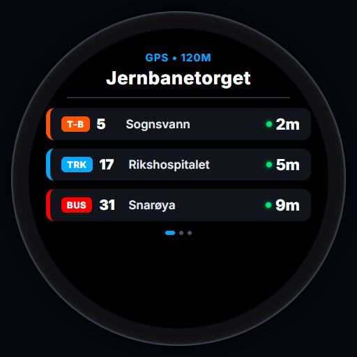
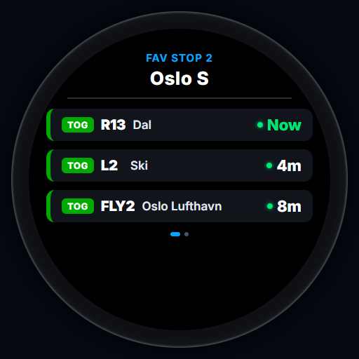
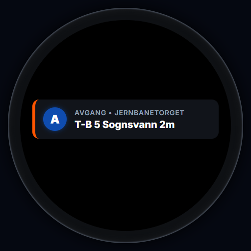
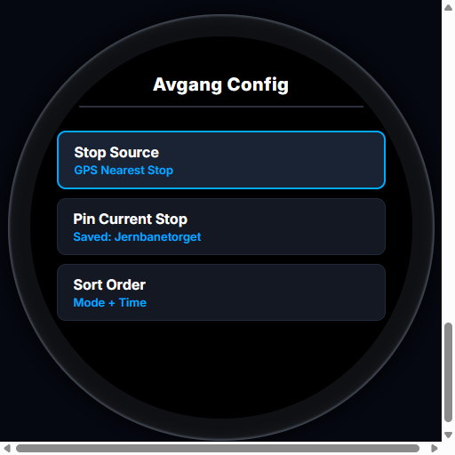

# Avgang — Live Transit Norway



A native Garmin Connect IQ widget displaying real-time public transport countdowns across Norway directly from the **Entur JourneyPlanner v3 GraphQL API** and **Entur Geocoder API**.

> **Device Compatibility Note:** This widget was **developed primarily and optimized for the Garmin fēnix 6S** (`fenix6s` / `fenix6spro`). It is also built and packaged for other circular Garmin watches with identical or similar screen layouts (fēnix 6/7 series, Epix 2, Forerunner 255/265/955/965, and Enduro), with UI elements and font sizing tuned specifically for the fēnix 6S display.

---

## Visual Overview

| Multi-Modal Board | Train Departures | Widget Glance | On-Watch Config |
| :---: | :---: | :---: | :---: |
|  |  |  |  |
| Metro, Tram & Bus | Regional & Commuter Rail | Live Widget Glance | Stop Source & Pin Menu |

---

## Features

1. **Zero Backend Required**:
   - Communicates directly with `https://api.entur.io/journey-planner/v3/graphql` and `https://api.entur.io/geocoder/v1/autocomplete` over Bluetooth via Garmin Connect Mobile.
   - Ultra-compact GraphQL queries engineered to stay safely within Garmin's memory budget.

2. **Multi-Modal Color Badges**:
   - Supports all Norwegian public transit modes: **Bus (`BUS`)**, **T-bane / Metro (`T-B`)**, **Tram / Trikk (`TRK`)**, **Train (`TOG`)**, and **Ferry / Boat (`BAT`)**.
   - Chronological sorting grouped by transit mode (whichever mode departs soonest is placed first).

3. **5 Flexible Stop Sources**:
   - **`GPS Nearest Stop`**: Uses your watch's GPS to find the closest transit stop wherever you are standing.
   - **`Favorites 1–3`**: Preset stops configured in the Garmin Connect Mobile app by human-readable name (e.g. `"Jernbanetorget"`, `"Majorstuen"`) or NSR Stop ID (`"NSR:StopPlace:59872"`).
   - **`Pinned Stop`**: Save any stop directly on the watch for instant indoor lookups before walking out the door.

---

## On-Watch Controls

| Button | Action |
| :--- | :--- |
| **START / STOP** (Top-Right) | Immediately refresh live departures from Entur |
| **DOWN** (Bottom-Left) | Scroll down through upcoming departures |
| **UP** (Middle-Left) | Scroll up through upcoming departures |
| **Hold UP / MENU** (Middle-Left) | Open on-watch **Avgang Config** menu |

---

## On-Watch Configuration & Stop Sources

Hold the **UP / MENU** button inside the widget to open the **Avgang Config** menu.

### 1. Stop Source
Pressing **Stop Source** cycles through the 5 transit sources:

| Source | Description | Typical Use Case |
| :--- | :--- | :--- |
| **`GPS Nearest Stop`** | Uses watch GPS coordinates to find the nearest stop place. | Exploring unfamiliar areas or traveling around town. |
| **`Fav 1`** *(Default: Jernbanetorget)* | Loads your 1st preset stop configured in phone settings. | Primary morning commute station. |
| **`Fav 2`** *(Default: Majorstuen)* | Loads your 2nd preset stop configured in phone settings. | Work, school, or study hub. |
| **`Fav 3`** *(Default: Nationaltheatret)* | Loads your 3rd preset stop configured in phone settings. | Gym, evening meetup, or weekend spot. |
| **`Pinned Stop`** | Loads the stop saved directly on the watch via **Pin Current Stop**. | Instant indoor access without GPS lock or phone setup. |

> **Tip:** You can customize favorite stop names anytime in the **Garmin Connect Mobile app** under *App Settings*.

### 2. How to Use "Pin Current Stop" (Indoor Shortcut)
* **The Problem:** GPS cannot reliably acquire satellite lock indoors (inside your apartment, hallway, or office before heading out), and typing a new stop name in the mobile app settings is tedious on the go.
* **How to Use:**
  1. While outdoors near a stop you use regularly, cycle **Stop Source** to **`GPS Nearest Stop`** and wait for departures to load.
  2. Hold **UP / MENU** to open the config menu.
  3. Select **Pin Current Stop** (press **START**).
  4. The menu updates to `Saved: <Stop Name>` and switches your active source to **Pinned**.
  5. Whenever you check the widget before stepping out the door, it will instantly fetch live countdowns for that exact stop with **zero GPS wait** and **no phone typing needed**.

### 3. Sort Order
Toggles between:
* **`Mode + Time` (Default)**: Groups departures by transit mode (prioritizing whichever mode has the earliest departure) and sorts chronologically within each mode.
* **`Time Only`**: Pure chronological order across all modes.

---

## Quick Start & Sideloading

To install the widget directly onto your physical Garmin watch:

1. Connect your watch to your computer via USB.
2. In File Explorer, navigate to the watch drive: `GARMIN/APPS/`.
3. Copy `bin/Avgang.prg` into the `GARMIN/APPS/` folder.
4. Safely eject the watch. The widget will appear in your glance loop!

---

## Building & Running in the Simulator

1. Install the **Garmin Connect IQ SDK Manager** and the **Monkey C** VS Code extension.
2. Download target device definitions (e.g. `fenix6s`) in the SDK Manager.
3. Generate a developer signing key:
   ```bash
   openssl genrsa -out developer_key.pem 4096
   openssl pkcs8 -topk8 -inform PEM -outform DER -in developer_key.pem -out developer_key.der -nocrypt
   ```
4. Compile for `fenix6s`:
   ```bash
   monkeyc -f monkey.jungle -d fenix6s -o bin/Avgang.prg -y developer_key.der -r -w
   ```
5. Run unit tests in the simulator:
   ```bash
   monkeyc -f monkey.jungle -d fenix6s -o bin/AvgangTest.prg -y developer_key.der -t
   # Note: on Windows monkeydo requires /t (forward slash)
   monkeydo bin/AvgangTest.prg fenix6s /t
   ```
6. Package for Connect IQ Store:
   ```bash
   monkeyc -e -f monkey.jungle -o bin/Avgang.iq -y developer_key.der -r -w
   ```

---

## Privacy Policy

This widget respects your privacy: zero trackers, zero developer backends, and no personal data collection. Read the full [Privacy Policy](PRIVACY.md).

---

## Data Attribution & Licensing

### Public Transport Data
Contains public transit data delivered by **Entur AS** made available under the [Norwegian License for Open Government Data (NLOD 2.0)](https://data.norge.no/nlod/en/2.0) and [Creative Commons Attribution 4.0 International (CC BY 4.0)](https://creativecommons.org/licenses/by/4.0/).

This application is independent and not affiliated with, endorsed by, or operated by Ruter AS or Entur AS.

### Software License
This project is open-source software licensed under the [MIT License](LICENSE).
